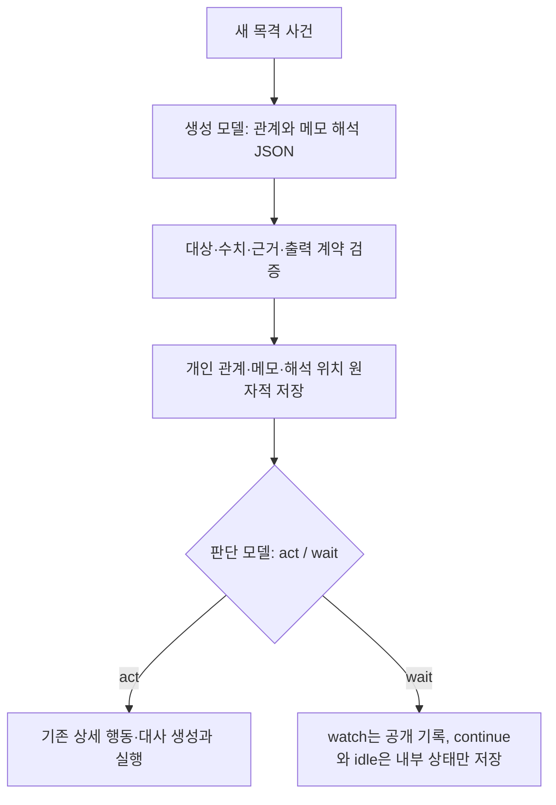

# 캐릭터 관계와 관찰 해석

현재 구현의 계약이다. 캐릭터의 관계는 해당 인스턴스가 상대를 어떻게 생각하는지를 나타내는 비공개 상태다. 자신의 관계와 기본 성격·목표·목격 기억을 함께 보고 행동 여부와 상세 행동을 추론한다.

## 데이터와 초기 설정

`EntityInstance.relationships`는 상대 ID를 키로 하는 객체다. 플레이어는 `player`로 표현한다. 원형에 관계를 공유하지 않으며, 서연→지은과 지은→서연은 독립적이다. 각 관계에는 다음을 저장한다.

| 필드 | 의미 |
| --- | --- |
| `trust` | 말·약속을 얼마나 믿는가 |
| `affinity` | 얼마나 호감을 느끼는가 |
| `closeness` | 얼마나 가깝고 편하게 느끼는가 |
| `respect` | 능력·판단·가치를 얼마나 인정하는가 |
| `wariness` | 얼마나 위협을 느끼거나 조심하는가 |
| `impression` | 상대에 대한 짧은 주관적 인식, 최대 600자 |
| `evidenceEventIds` | 최근 관계 갱신의 근거가 된 목격 사건 ID, 최대 8개 |

다섯 수치는 독립적인 0~100 정수 또는 `null`이다. `null`과 관계 항목 자체의 부재는 미평가를 뜻하며 중간값 50으로 치환하지 않는다. 높은 호감과 낮은 신뢰, 높은 친밀도와 높은 경계도가 공존할 수 있다. 특정 수치로 동행·복종·동의나 행동 여부를 강제하는 계산식은 없다.

초기 관계는 세계관 정의의 `spawns[].relationships`에 지정한다. 예를 들어 하린의 초기 배치에 다음을 추가한다.

```json
{
  "relationships": {
    "player": {
      "trust": 80,
      "affinity": 85,
      "closeness": 90,
      "respect": 65,
      "wariness": 5,
      "impression": "함께 시간을 보내기 편한 오랜 친구. 믿지만 내 의견도 말한다.",
      "evidenceEventIds": []
    }
  }
}
```

초기 관계에는 실행 중 사건의 근거를 지정하지 않는다. 대상은 같은 세계관의 다른 캐릭터 또는 플레이어여야 하며 자신·오브젝트·존재하지 않는 ID는 거부한다. 초기화는 정의에 설정한 초기 관계를 복제한다. 원형이 같아도 관계 객체는 공유하지 않는다.

예제 세계관의 서연·지은은 함께 연습한 배우와 연출가이고, 하린은 플레이어와 오래 알고 지낸 방문객으로 설정했다. 역할·알고 있는 범위·말투를 구체화하고 이 배경에 맞는 초기 관계를 배치했다. 이미 저장된 세계관의 설정을 예제 설정으로 덮어쓰지는 않는다.

## 실행 흐름



`Director.reflect()`는 `/chat/completions`의 `character_reflection` JSON Schema를 사용한다. 세션의 생성 모델 ID를 사용하며 작업 재개 시에도 해당 작업이 수락한 모델 ID를 유지한다. 판단 모델은 `/systemone`에서 `participation`의 `act/wait`와 비참여 태도인 `inactivity`의 `watch/continue/idle`을 같은 요청으로 고른다. 하던 일을 계속하거나 아무것도 하지 않는 선택은 공개 사건을 만들지 않지만, 그 전에 목격한 사건에 대한 관계·메모 해석은 저장한다.

자기 행동과 단순 `wait`를 제외한 미처리 목격 사건을 한 번에 최대 16개씩, 오래된 것부터 해석한다. 근거 문맥에는 해당 묶음과 마지막 사건까지의 최근 기억 최대 32개를 합친다. 이후 사건을 일반 최근 기억 창을 통해 먼저 읽지 않도록 해석 입력의 기억 범위도 맞춘다. 처리할 새 사건이 없으면 해석 호출을 생략한다. 모든 묶음의 해석이 끝난 뒤 최신 관계·메모로 행동 여부를 판단한다.

따라서 인물이 아무 말 없이 지켜보기로 해도 관계는 변할 수 있다. 관계와 메모 갱신은 개인 상태만 바꾸며 외부 사건을 발행하거나 다른 인물을 깨우지 않는다. 다른 인물의 입력에는 해당 관계·인식·근거·메모를 전달하지 않는다. 수치와 인식은 해당 캐릭터의 해석이며 세계의 객관적 사실로 취급하지 않는다.

분노·질투·서운함·고마움 같은 현재 감정은 기존 `memo.feelings`에 상대와 원인을 서술한다. 장기 관계 수치에 자동 감쇠나 정해진 증감을 적용하지 않는다.

## 해석 출력과 검증

```json
{
  "relationshipUpdates": [
    {
      "targetId": "player",
      "changes": [
        { "field": "trust", "value": 45 }
      ],
      "impression": "약속은 들었지만 실제 준비 상태를 확인하고 싶다.",
      "evidenceEventIds": ["실제로-입력받은-목격-사건-ID"]
    }
  ],
  "memoUpdate": null
}
```

`changes`는 변경할 항목만 담으며 `value`는 변경 후 절대값이다. `null`은 해당 수치를 미평가로 바꾸는 명시적 변경이다. 변경하지 않을 항목은 배열에 넣지 않는다. `impression: null`은 기존 인식을 유지하며 빈 문자열은 인식을 비운다. 갱신할 관계가 없으면 `relationshipUpdates: []`를 반환한다. 메모는 기존 네 필드 전체 또는 유지할 때 null이다.

한 응답에서 최대 8명의 관계, 한 상대에 최대 5개 수치 변경을 허용한다. 대상과 수치 항목의 중복·추가 필드·범위 밖 수치·알 수 없는 대상·다른 주체의 관계 변경은 거부한다. 출력에는 주체 ID가 없고 실행기가 현재 인물을 주체로 고정한다.

대상 후보에는 이미 관계가 있는 상대, 현장의 인물, 근거 문맥에서 목격한 주체·대상 중 유효한 캐릭터·플레이어만 넣는다. 각 갱신에는 입력으로 제공한 목격 사건의 ID가 필요하며, 반드시 새 사건을 하나 이상 포함해야 한다. 과거 사건만으로 같은 평가를 반복하거나 목격하지 않은 사건을 근거로 쓰지 못한다. 다만 근거의 자연어 해석이 타당한지까지 타입 검증이 증명하지는 않는다.

모든 갱신을 검증한 다음에만 적용한다. 잘린 JSON·추가 필드·유효하지 않은 제안은 기존 백오프 정책으로 해석 호출만 다시 시도한다. 재시도 중에는 관계를 적용하지 않는다. 한도를 소진하면 작업이 실패하며 앞서 저장한 상태는 유지한다.

## 저장·재시작·진행 중 채팅

관계와 개인 메모, 마지막으로 해석한 사건 ID인 `reflectedThroughEventId`를 기존 `theater_worlds.state_json`과 작업 진행 위치에 함께 저장한다. 별도 DB·테이블을 만들지 않는다. 같은 tick에도 여러 사건이 발생하므로 tick 대신 사건 ID를 사용한다.

해석을 저장한 뒤 판단이 실패하거나 서버가 재시작되면, 저장한 관계와 커서를 사용해 판단부터 이어간다. 같은 사건으로 관계를 중복 갱신하지 않는다. 저장 전에 중단된 해석은 다시 추론할 수 있다.

추론 도중 새 채팅이 도착하면 기존 관찰의 미확정 해석을 버린다. 채팅을 먼저 반영하고 남은 새 목격 사건을 다시 해석한다. 이미 저장한 관계·메모·행동은 유지한다. 외부 편집과 실행권 변경은 기존 리비전·worker 소유권 검증으로 처리한다.

슬롯·내보내기·가져오기는 관계와 해석 위치를 함께 보존한다. 구형 version 2 데이터에서 관계가 생략되었으면 빈 객체, 커서가 생략되었으면 null로 읽는다. 원래 기억과 사건은 유지한다. 처음 새 실행기를 사용할 때는 아직 해석하지 않은 과거 목격 사건도 묶음으로 처리한다. 저장된 근거·커서가 그 인물의 목격 기억과 일치하는지도 검사한다.

## 화면과 설정

공연 화면의 **세계관과 현재 인물의 기억 → 인물 → 상대별 관계**에서 수치·인식·근거를 확인할 수 있다. 이는 플레이어가 이야기 속에서 읽은 정보가 아니라 기존 기억 보기와 같은 상태 확인 화면이다.

편집 화면의 **배치·관계 → 인물**에서 편집 시점(지금의 모습/이야기 시작 시점)을 고르고, **상대별 관계**에서 상대 선택·슬라이더·숫자·미평가 옵션·인식 문장으로 수정한다. 현재 관계 편집은 기존 근거·커서를 보존한다. 초기 관계 편집은 현재 진행을 덮어쓰지 않는다. [작업실 사용 안내](EDITOR_GUIDE.md)를 참고한다.

해석 출력 토큰 한도는 `NEWERA_REFLECTION_MAX_OUTPUT_TOKENS` 또는 `models.json`의 `reflectionMaxOutputTokens`로 설정한다. 기본값은 1024, 범위는 1~32768이다. 기존 `maxOutputTokens` 기본값 512는 상세 행동 생성에 적용한다. 두 설정 모두 기존 모델 설정의 파일 우선순위·다음 작업 연결 시 재읽기·유효하지 않은 변경 시 마지막 설정 유지 규칙을 따른다. 재개한 worker는 저장한 모델 ID를 사용하고 연결·출력·재시도 설정은 현재 유효 설정을 읽는다.
