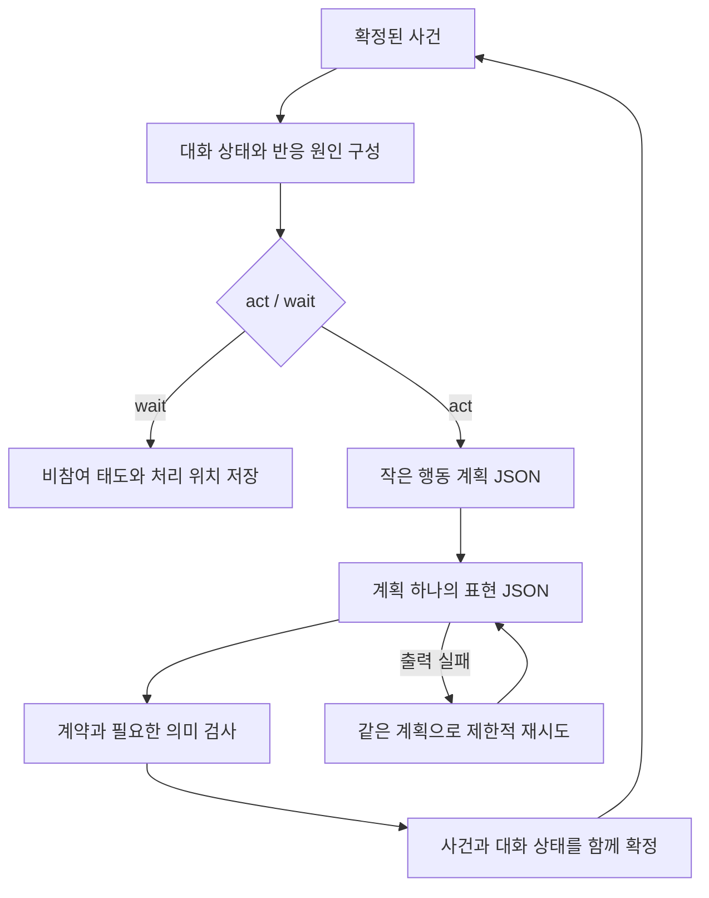

# 대화 상태와 목적별 컨텍스트 설계

상태: **대화 상태·계획 분리는 검토안, LanceDB 과거 기억 검색은 구현**. 작성일: 2026-10-23 KST.

이 문서는 대화 목적을 잃는 반응과 구조화된 생성 실패를 줄이기 위한 다음 변경의 범위를 정한다. 현재 동작은 [PRODUCT.md](PRODUCT.md), 실제 계약은 [types.ts](../src/lib/theater/types.ts)와 실행 코드가 기준이다. 아래의 대화 프레임·반응 작업·계획/표현 분리는 새 제안이다. 이 문서 작성 과정에서 실행 코드나 진행 데이터는 변경하지 않았다.

## 1. 확인된 문제와 아직 모르는 것

| 관찰 | 확인한 사실 | 이 사실만으로 단정할 수 없는 것 |
| --- | --- | --- |
| 사용자가 교실로 가고 싶다고 했지만 서우가 인사로 돌아감 | 마지막 사용자 입력은 유지되지만, 반응 큐에는 인물 ID만 있고 응답할 사건·대화 목적·대기 중인 답이 별도로 없음 | 기억 창을 늘리면 해결된다는 보장 |
| 양순자가 플레이어처럼 자기소개함 | 모델이 만든 역할 혼동이 기록·메모에 들어가면 뒤의 인물이 이를 다시 참고함. 현재 화자 표시와 별도 검수가 추가되어 있음 | JSON 필드에 actorId가 있으면 자연어의 주체도 항상 정확하다는 보장 |
| `invalid_model_output`, `Expecting value: line 1 column 1` | OEV가 모델 출력을 JSON으로 해석하지 못해 502를 반환함. 클라이언트가 유효한 생성 결과를 받은 상태가 아님 | 빈 출력·비JSON 문장·코드 펜스·생성 종료 문제 중 무엇이 원인인지는 원문 없이 구분 불가 |

[현재 OEV 문서](http://macstudio:12821/.skill)는 JSON 출력 검증을 지원하지만 grammar-constrained decoding은 지원하지 않는다고 명시한다. `json_schema`와 `strict: true`만으로 모델이 유효한 JSON을 반드시 생성하도록 강제되는 구조는 아니다. 따라서 대화 상태 개선과 JSON 생성 안정화는 관련이 있어도 각각 검증해야 한다.

이번 조사 시 양순자의 생성 입력은 system 지침과 전송 포장을 제외해도 11,895바이트, 출력 스키마는 987바이트였다. 최근 사건은 8개, 합법적인 행동 후보는 7개였다. 기본 출력 한도는 512토큰인데 행동 선택·대상·묘사·대사·메모 전체를 한 번에 요청한다. 메모 스키마의 허용 최대 길이와 출력 토큰 예산이 맞물려 있지 않다. 이 복잡성과 예산은 개선 대상이지만, 이번 502의 확정 원인으로 단정하지 않는다. 측정은 저장된 장면의 읽기 전용 분석이며 입력 길이는 이후 진행에 따라 달라진다.

## 2. 유지할 원칙

- 판단의 기본 질문은 계속 `act / wait`로 둔다. 구체적인 행동은 생성 모델의 구조화된 계획에서 고른다.
- 인물은 여러 번 참여할 수 있다. 참여 횟수나 일정 라운드 수로 대화를 끝내지 않는다.
- 극중 중단 요구는 인물의 판단 대상이고, 운영 UI의 생성 중단은 즉시 실행 권한을 회수한다.
- 플레이어의 이름·답변·동의·이동을 NPC가 대신 확정하지 못한다.
- 원래 사건의 주체·대상·순서를 보존한다. 메모와 요약은 사실 기록을 덮어쓰지 않는다.
- 하나의 인물에게 타인의 비공개 메모나 목격하지 않은 사건을 전달하지 않는다.
- DB는 기존 SQLite와 세계관 JSON을 사용한다. 이 변경에 새 DB나 벡터 저장소는 필요하지 않다.

## 3. 최근 사건 창에 더할 상태

### 대화 프레임

씬 전체에 단일 주제를 강제하지 않고, 같은 씬에서도 여러 대화 프레임을 유지한다. 플레이어와 서우의 안내 대화에 양순자의 인사가 끼어들어도 안내 목적을 지우지 않는다.

프레임에는 다음만 둔다.

| 항목 | 의미와 확정 주체 |
| --- | --- |
| `id`, `createdFromEventId` | 실행기가 부여한 대화 ID와 시작 사건 |
| `participantIds` | 실제 발언 주체·대상으로 확인된 참여자. 현장의 모든 인물을 자동 참여자로 보지 않음 |
| `topic`, `requestedOutcome` | 출처 사건을 가진 요청 주제와 목적. 요청 자체와 완료 사실을 구분 |
| `status` | `active / waiting / closed`. 모델 호출 실패와 별개의 이야기 상태 |
| `pendingQuestions` | 질문 사건, 질문한 사람, 답할 사람, 질문 내용, 처리 상태 |
| `commitments` | 누가 무엇을 하겠다고 했는지와 근거 발언. 약속과 실제 실행 결과를 구분 |
| `lastUpdatedEventId` | 마지막으로 반영한 사건 |

자연어 요청·질문·약속의 의미 추출은 작은 구조화된 제안으로 받는다. 주체·대상·출처 ID·허용된 상태 전이는 실행기가 검증한다. 모델의 해석을 자동으로 객관적 세계 사실로 승격하지 않는다. 질문 여부를 물음표나 단어 목록만으로 판정하지 않는다.

공개 대화 연결 정보와 캐릭터의 비공개 의도를 분리한다. 프레임 전체를 모든 인물에게 보내지 않고, 해당 인물이 실제로 목격한 사건으로 만든 뷰만 전달한다. 대화 주제가 같다는 이유로 다른 씬의 대화를 유출하지 않는다.

### 인물별 현재 과제

자유문장 `memo.currentIntention`과 별개로 출처가 있는 현재 과제를 둔다. 과제는 제안·수락·진행·대기·완료·포기를 구분한다. 감정과 장기 관계는 기존 개인 메모와 관계에 남긴다.

예를 들어 서우의 상태는 다음 의미를 가져야 한다. 아래 필드는 제안이며 현재 저장 형식이 아니다.

```json
{
  "actorId": "seo-woo",
  "threadId": "guide-thread",
  "task": {
    "goal": "플레이어가 교실로 가도록 안내한다",
    "status": "waiting",
    "waitingForActorId": "player",
    "waitingFor": "플레이어의 이동 또는 다음 답변",
    "sourceEventIds": ["player-request", "seo-woo-acceptance"]
  }
}
```

“따라와”라는 발언은 안내 의사이지 이동 완료가 아니다. 실제 위치와 경로는 기존 씬 연결과 실행된 이동 사건으로만 바꾼다. 서우가 이름을 한 번 묻는 것을 금지할 필요도 없다. 이름 질문이 생겨도 교실 안내 과제는 유지하고, 사용자 답이 오기 전 같은 질문을 새 질문처럼 되풀이하지 않도록 한다. 새 사정이나 감정 변화에 따른 재촉·재질문은 별도 의도로 표현할 수 있다.

## 4. 반응 큐에 원인을 보존

현재 `pendingActorIds`를 다음 의미의 반응 작업으로 확장한다.

```json
{
  "actorId": "seo-woo",
  "triggerEventIds": ["sun-ja-greeting"],
  "threadId": "guide-thread",
  "reason": "witnessed_speech"
}
```

이렇게 하면 서우의 입력은 “양순자가 플레이어에게 인사했음 / 나는 교실 안내 중이며 플레이어 응답을 기다리는 중”으로 구성된다. 새 발언을 목격했다는 이유만으로 대화 목적을 새로 만들지 않는다. 현장 인물을 깨울 수는 있지만, 끼어들 필요가 없으면 `wait`를 선택할 자료를 준다.

같은 인물에게 여러 사건이 쌓이면 원인 ID를 중복 없이 합친다. 최신 사건 하나로 기존 요청이나 기다리던 답을 덮어쓰지 않는다. 대답의 직접 대상, 약속·과제 관련자, 일반 목격자의 구분은 처리 우선순위이지 행동 강제가 아니다.

사건 ID로 출처를 참조하고, 같은 tick 내 순서는 저장된 사건 순서로 구분한다. 단조 증가 `eventSeq`를 추가한다면 tick이나 벽시계 시각으로 대체하지 않는다. 조회와 저장 위치를 함께 이전한다.

## 5. 요청마다 만드는 작은 컨텍스트

캐릭터별 ContextBuilder가 목적별 입력을 만든다. 현재 과제·질문·약속의 근거는 출처 ID·인물 ID·대화 ID와 장면 관계로 우선 고른다. 오래된 관련 기억은 아래의 BM25·벡터 검색으로 보충한다. 검색 순위 때문에 현재 과제의 필수 근거를 빼지 않는다.

| 단계 | 필수 입력 | 기본적으로 제외 |
| --- | --- | --- |
| 대화 의미 추출 | 새 사건, 실제 주체·대상, 관련 프레임의 짧은 상태 | 세계관 전문, 의상·음식 취향, 전체 관계 |
| 참여 판단 | 고정 정체성, 이번 반응 원인, 현재 과제, 기다리는 질문/답, 관련 감정·관계 | 전체 과거 대화, 무관한 인물·사물, 장문의 배경 |
| 행동 계획 | 참여 판단 입력과 합법적인 행동 후보, 답할 사건/프레임 후보 | 문체 지침, 의상 설명, 메모 전체 재작성 요구 |
| 말/행동 표현 | 확정된 자기 계획, 발언 대상, 답할 발언 원문, 직접 필요한 사실·말투·문체 | 모든 행동 후보, 관계 전체, 메모 갱신, 무관한 세계관 규칙 |
| 정체성 검사 | 변하지 않는 자기 정체성과 새 제안 | 대화 원문 전체와 오염 가능성이 있는 요약 |
| 관계·감정 해석 | 자기 관점, 관련 상대, 아직 처리하지 않은 목격 사건과 그 근거 | 행동·대사 선택과 공개 세계 상태 수정 |

원문 사건은 한 번만 넣는다. 기본 설정, 현재 상태, 새 자극, 과거 맥락, 주관적 해석을 서로 다른 필드로 표시한다. 충돌하면 확정된 설정·실행 기록을 우선한다.

최근 N개만 고르는 대신 필수 출처를 먼저 포함한다. 현재 사용자 요청, 약속 근거, 아직 답하지 않은 질문, 이번 반응 원인은 최근 창 밖이어도 필요하다. 과거 참고 자료만 예산에 따라 줄인다. 필수 자료가 예산에 들어오지 않으면 질문/사건 처리를 더 작게 나누거나 명시적으로 실패시키며, 주체·대상이나 질문의 핵심을 몰래 잘라내지 않는다.

초기 크기 예산은 하드코딩한 토큰 추정식이 아니라 관측 가능한 운영 목표로 둔다. 요청별 JSON 바이트, 서버가 반환한 실제 입력/출력 토큰, 필수 출처 개수, 소요 시간, 실패 단계를 기록해 조정한다. 입력 길이와 품질·지연은 따로 비교한다. 동작에 영향을 주는 예산을 도입할 때는 기존 `models.json` 설정과 검증·재읽기 규칙을 사용한다.

### 장기기억의 BM25·벡터 검색

LanceDB와 연결된 OEV의 `embeddinggemma2`(기본 768차원)를 도입했다. 현재 구현·설정·복원·장애 규칙과 검증 결과는 [장기기억 검색](MEMORY_SEARCH.md)에 정리했다.

- 원본 사건과 실제 목격 범위는 SQLite가 소유한다. LanceDB는 재구성 가능한 파생 색인이다.
- 세계관별 테이블과 목격자 필터를 적용한 BM25·코사인 벡터 검색을 RRF로 결합한다. 발언 주체와 그 발언을 목격한 관찰자 ID를 구분한다.
- 최근 기억 16개 밖의 과거 사건을 검색해 별도 `recalledEvents`로 전달한다. 참여 판단에는 최대 2개, 검수에는 기본 최대 4개·원문 JSON 6000바이트 이내다. 상세 생성에는 [약 32K 생성 히스토리](GENERATION_HISTORY.md)를 사용하고 같은 사건을 검색 결과로 반복하지 않는다. 과거 사건을 새 사건으로 재평가하지 않는다.
- 한국어는 사전 없이 동작하는 2~3자 n-gram이 기본이다. `교실` → `교실로` 검색을 검증했다. Ko-dic 사전이 준비되면 `lindera/ko-dic`을 설정할 수 있지만 현재 환경의 사전 설치와 형태소 분석 품질은 검증하지 않았다.
- 서버·모델·차원·토크나이저·텍스트 버전이 바뀌면 별도 색인을 사용한다. 매 조회에서 원본 ID·내용·목격 범위를 비교해 슬롯 복원·초기화·기록 복구 뒤 삭제된 사건을 다시 돌려주지 않는다.
- 임베딩 장애는 BM25, 색인 전체 장애는 최근 사건과 현재 메모로 진행하며 상태를 구분한다. 검색 장애는 기억 부재가 아니다.

대화 프레임·미응답 질문·현재 과제와 그 필수 출처를 고정하는 작업은 아래 설계대로 아직 남아 있다. 과거 검색만으로 그 상태 보존을 대체하지 않는다.

## 6. 계획과 표현을 분리

현재 한 번의 생성에서 요청하는 다섯 필드를 다음 두 호출로 나눈다. 구체적인 행동 선택은 계속 생성 모델의 구조화된 추론이다.



1. **행동 계획:** 어떤 행동 ID를 실행하고, 어떤 사건/대화에 응답하며, 무슨 의도로 참여할지를 작은 JSON으로 받는다.
2. **표현:** 검증한 계획 한 개에 맞는 `narrative`와 `utterance`만 생성한다.

계획의 예시:

```json
{
  "actionId": "speak:player",
  "threadId": "guide-thread",
  "replyToEventId": "player-request",
  "intent": "confirm_guidance"
}
```

화자·대상은 실행기가 해당 인물과 행동 ID에서 고정한다. 표현 단계에 화자나 행동을 다시 고르게 하지 않는다. 선택한 행동 종류에 맞춰 말하기는 대사, 이동/조작은 행동 묘사를 요구하는 작은 스키마를 만든다.

```json
{
  "narrative": "앞마당으로 이어진 길을 가리킨다.",
  "utterance": "교실은 이쪽이야. 앞마당부터 지나가자."
}
```

계획만으로 질문·약속·이동을 확정하지 않는다. 실제 표현이 계획과 맞고 검증을 통과한 뒤에 공개 사건과 프레임 변경을 함께 저장한다. 거절한 표현은 사건·목격 기억·메모에 넣지 않는다. 프레임 ID가 맞다고 문장 의미까지 자동 보장되는 것은 아니므로, 의심되는 역할·응답 관계만 작은 입력으로 검사한다. 일반 검수를 계속 덧붙이는 방식으로 해결하지 않는다.

전체 메모 재작성은 표현에서 분리한다. 성공한 발언 뒤 메모 처리만 실패했다면 그 위치에서 재시도하고, 발언을 재생성하지 않는다. 과제의 진행은 검증한 계획과 실제 실행 사건으로 갱신하며, 인물의 내면은 별도 해석으로 유지한다.

## 7. 재시도와 저장 위치

| 확정 지점 | 실패 시 유지할 것 | 다시 할 것 |
| --- | --- | --- |
| 사용자 입력 저장 | 입력·시간 진행·입력 소비 위치 | 남은 해석/판단 |
| 관계·대화 해석 저장 | 관계·프레임·근거 처리 위치 | 이후 단계 |
| 자기 행동 계획 검증 | 아직 공개하지 않은 계획과 관찰 리비전 | 같은 계획의 표현 |
| 표현·검수 완료 | 검증된 제안, 아직 미실행 | 원자적 확정 |
| 사건 확정 | 대사·행동·효과·대화 상태·큐 위치 | 이후 메모/다음 반응 |

재개 상태는 프로세스 메모리만이 아니라 작업 JSON에 저장한다. 표현 재시도는 모델·계획·대상·반응 원인을 유지한다. 새 사용자 입력·세계관 변경·작업 소유권 상실이 생겼으면 미확정 계획과 표현을 폐기하고 최신 사건으로 다시 구성한다. 이미 확정한 발언은 다시 실행하지 않는다.

502의 출력 형식 오류, 전송 실패, 시간 초과, 정상 JSON의 계약 위반, 의미 검수 거절을 별도로 표시한다. 실제 JSON을 받지 못한 502에 “화자를 잘못 생성했다”는 수정 지침을 붙이지 않는다. 현재 생성 재시도의 일반 역할 교정 메시지는 이 구분을 반영하도록 바꿀 대상이다.

OEV 쪽 점검은 원문 없이 남는 502를 진단할 수 있어야 한다. 가능하면 요청 상관 ID, 모델, finish_reason, 토큰 사용량, 실패 분류를 제공받는다. 원시 모델 출력은 대화/개인 설정을 포함할 수 있으므로 기본 로그에 쌓지 않고, 필요할 때 명시적으로 제한된 로컬 진단으로만 수집한다. 이 문서는 OEV 서버 변경을 수행하거나 원문 원인을 확인한 기록이 아니다.

스키마와 정상 완료 검증, 제한된 백오프, 수동 재시도, 운영 중단은 유지한다. 실패한 JSON을 평문 대사로 표시하거나, 실행기가 가짜 근거·이름·선택을 채워 넣어 통과시키지 않는다. 모델을 임의로 교체하지 않는다.

## 8. 구현 순서와 확인 기준

### 첫 변경: 실패가 대화 목적을 바꾸지 않게 하기

- 반응 작업에 원인 사건을 저장하고, 현재 대화 요청·대기 중인 답·인물 과제를 최소 상태로 유지한다.
- 행동 계획과 표현을 분리하고 메모 전체 갱신을 표현 요청에서 제거한다.
- 표현 실패 후에는 저장된 계획으로 재시도한다. 오류 유형별 재시도 지침을 구분한다.

이 세 가지를 하나의 사용 흐름으로 검증한다. 우선 인물 전체 지식 검색이나 새로운 감정 체계를 추가하지 않는다.

### 다음 변경: 선택과 저장 범위를 정교하게 하기

- 관련 프레임·약속·사건을 출처 ID로 검색하고 목적별 예산을 적용한다.
- 슬롯·내보내기·가져오기·재시작에서 프레임·과제·세부 실행 위치를 보존한다.
- 기존 version 2 저장에는 새 필드를 선택 항목으로 추가한다. 옛 actor ID 큐는 원인을 모르는 작업으로 읽고, 근거 없이 과거 약속을 생성하지 않는다. 정의만 가져온 새 세계관은 비어 있는 프레임/과제로 시작한다.

### 최소 검증 시나리오

1. “교실부터 가고 싶어” → 서우 동의 → 양순자 인사: 안내 과제와 사용자 응답 대기가 유지된다. 짧은 인사는 허용하되 사용자가 답하지 않은 이름 질문을 새 질문처럼 반복하지 않는다.
2. 서우가 플레이어에게 질문: 양순자가 이를 자신의 질문으로 받거나 플레이어 이름을 대신 답하지 않는다.
3. 표현에서 502가 나고 수동 재시도: 대상·의도·응답 사건은 유지되고 사용자 입력·시각·완료 발언은 중복되지 않는다.
4. 표현을 기다리는 동안 새 채팅/운영 중단: 이전 리비전의 결과는 저장되지 않는다.
5. 장면이 바뀌거나 다른 대화가 끼어듦: 미해결 과제는 남지만 목격하지 않은 대화와 타인의 비공개 메모는 유출되지 않는다.
6. 재시작/슬롯 복원: 이미 답한 질문·수락한 약속·계획/표현 처리 위치가 중복 적용되지 않는다.

품질 개선, JSON 성공률, 입력 크기, 호출 횟수, 전체 지연을 각각 측정한다. 작은 요청이 많아졌다는 이유만으로 더 빠르거나 안정적이라고 결론 내리지 않는다. 현재 별도 화자 검수는 방어 수단으로 유지하되, 안정된 상태/계획 구조가 생긴 뒤 중복 검수를 줄일지 실제 결과로 결정한다.
