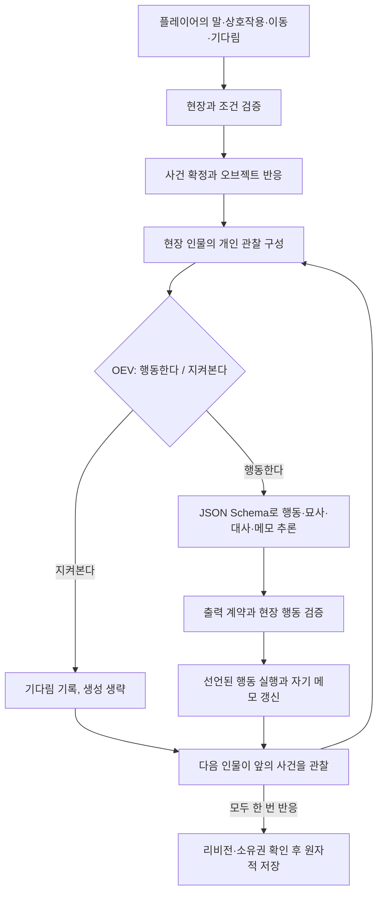

# newera의 무대 실행 구조

현재 구현의 구조와 수명주기를 설명한다. 타입과 검증의 기준은 `src/lib/theater/types.ts`, `validation.ts`다.

동적 동행·반복 반응과 더 풍부한 개인 메모의 확장 제안은 [반응형 씬 실행기 확장 설계](REACTIVE_SCENE_DESIGN.md)에 정리한다. 행동 여부 판단과 구조화된 상세 생성, 기본 개인 메모는 현재 구현에 반영되어 있다.

## 세계관, 씬, 인스턴스

`World`는 세계관 정의(`definition`)와 현재 진행(`state`), ID, 리비전을 소유한다. 정의에는 가장 큰 배경·규칙, 씬, 캐릭터·오브젝트 원형, 초기 배치가 있다. 씬은 이름·설명·출구를 가지며 인스턴스의 `sceneId`가 실제 현장 구성을 결정한다.

원형은 공유하는 설명·성격·목표·초기 상태·상호작용·사건 반응을 정의한다. 인스턴스는 고유 ID, 원형 참조, 현재 씬, 이름, 상태, 활성 여부, 동행 여부, 개인 기억을 소유한다. 같은 원형에서 만든 두 작업등을 켜도 서로의 상태는 변하지 않는다.

동행은 캐릭터 인스턴스의 수명주기다. 플레이어가 출구로 이동하면 현재 씬의 동행이 같은 ID·상태·기억을 유지하며 이동한다. 동행의 독자적인 이탈 이동은 후보에서 제외하지만 대사와 상호작용은 스스로 고른다. 일반 현지 인물은 각자 이동을 고를 수 있다.

## 사건과 반응

위 단계는 저장 전까지 메모리의 복제본에서 실행한다. 대상을 지정했으면 그 인물이 먼저 반응하고 나머지는 배치 순서를 따른다. 시작 시 현장에 있는 인물만 각각 한 번 평가하므로 반응이 무한히 이어지지 않는다. 현재 라운드에서 다른 씬으로 이동한 인물은 그 씬에 남고, 무대 밖 인물은 따로 시뮬레이션하지 않는다.

실행기가 현장에서 만드는 후보에는 현장 인물·플레이어에게 `speak`, 조건이 맞는 `interact`, 연결된 씬으로 `move`가 있다. 행동 여부를 판단한 뒤 생성 모델이 전체 후보 중 실제 행동 ID를 추론한다. 기다림은 판단에서만 선택하므로 생성 후보에서 제외한다. 플레이어의 입력 대사는 분류기를 거치지 않고 발화 사건이 된다. 플레이어의 오브젝트 상호작용과 이동은 명시적인 선택으로 실행한다.

`/systemone`에는 `participation`이라는 `choice` 질문 하나만 보낸다. 결과는 `act` 또는 `wait`이며 행동 종류나 강도는 판단하지 않는다. `wait`이면 생성 호출 없이 기다림을 기록한다. 판단 기록에는 행동 여부·판단 모델과 실제 행동 ID·생성 모델을 남긴다. 예전에 저장한 반응 신호·강도 필드는 읽을 수 있지만 새 판단에서는 만들지 않는다.

생성 모델은 `response_format: json_schema`로 `actionId`, `narrative`, `utterance`, `memoUpdate`를 출력한다. 행동 ID의 enum에는 모든 실행 후보를 넣는다. 말하기는 대사가 필수이고 다른 행동의 대사는 null이어야 한다. 이동·상호작용은 구체적 묘사도 필요하다. 임의의 추가 필드·후보 밖 행동·잘린 출력은 거부하며 일반 문자열로 자동 전환하지 않는다. 실제 상태 변화는 허용된 행동과 원형의 조건·효과를 실행기가 적용한다. 텍스트에 잘못된 내용을 쓰는 것까지 타입이 보장하지는 않는다.

## 관찰과 기억

사건은 해당 씬의 활성 캐릭터에게만 목격 기억으로 남는다. 이동에는 출발 씬의 `leave`와 도착 씬의 `enter`가 발생하며 동행도 이를 관찰한다. 다른 씬에 있던 인물은 이전 대화를 받지 않는다. 개인 상태·목표·기억은 해당 인물의 입력에만 넣는다. 다른 현장 캐릭터는 이름·설명으로, 오브젝트는 설명과 현재 상태로 관찰한다.

인물 입력은 최근 개인 기억 16개와 실제 목격한 사건 12개로 제한한다. 전체 기록은 저장하고, 기억 임베딩이나 백그라운드 벡터 쓰기는 사용하지 않는다.

개인 메모는 `summary`, `currentIntention`, `feelings`, `openThreads`로 구성하며 해당 인물의 판단·생성 입력에만 넣는다. 검증된 `memoUpdate` 객체가 있으면 자기 메모 전체를 교체하고 null이면 유지한다. 다른 인물의 메모나 실제 세계 상태는 수정할 수 없다. 메모는 진행·저장 슬롯·내보내기에 보존된다. 기존 version 2 파일에서 메모가 생략되어 있으면 null로 읽는다.

오브젝트의 상호작용은 자신의 상태 조건을 검사하고 선언된 `effects`만 적용한다. 사건 반응은 `on`, `targeted`, `conditions`가 맞으면 자신의 상태를 바꾸고 `change` 사건을 낸다. 반응으로 발생한 변화 사건은 같은 패스에서 재귀적으로 전파하지 않아 무한 반응을 막는다. 임의 스크립트 실행은 지원하지 않는다.

## 저장과 작업 소유권

`theater_worlds` 행은 세계관마다 정의·진행·리비전을 소유한다. 전역 선택 ID는 화면에서 어떤 세계관을 여는지만 결정하며 다른 세계관의 상태를 교체하지 않는다. 작업은 `world_id`, 시작 리비전과 요청을 저장하고 세계관당 하나만 활성화한다. 서로 다른 세계관의 작업은 독립적으로 실행할 수 있다.

worker는 15초 lease와 3초 heartbeat를 사용한다. 요청이나 상태 조회가 대기·만료 작업을 재개한다. 모델 대기 중 리비전 변경이나 실행권 상실을 발견하면 AbortSignal로 요청을 중단한다. 마지막 트랜잭션에서도 같은 소유권과 리비전을 확인한 뒤 진행과 작업 완료를 함께 저장한다. 실패하면 부분 사건과 상태를 저장하지 않는다.

설정 편집·슬롯 불러오기·진행 초기화는 리비전을 올린다. 슬롯 저장과 화면의 세계관 전환은 진행 리비전을 바꾸지 않는다. 슬롯은 정의와 진행을 함께 보관한다. JSON 가져오기는 전체 참조와 상태를 먼저 검증한 뒤 새 세계관으로 삽입한다.

저장소는 `theater_worlds`, `theater_meta`, `theater_saves`, `theater_jobs`로 구성한다. 씬 기반 version 2 파일만 가져올 수 있으며 구형 형식의 변환·자동 이전·원본 아카이브 보관은 지원하지 않는다.

## 현재 범위

2D·3D 그래픽 엔진은 없고, 씬은 텍스트 공간과 연결 관계다. 플레이어가 진행할 때만 현장 라운드를 실행한다. 실시간 배경 시뮬레이션, 동적 인스턴스 소환·삭제, 인벤토리와 범용 스크립트, 무제한 인물 간 대화 루프는 구현하지 않는다. 새로운 반응은 선언된 원형·상태·조건·효과로 확장한다.
