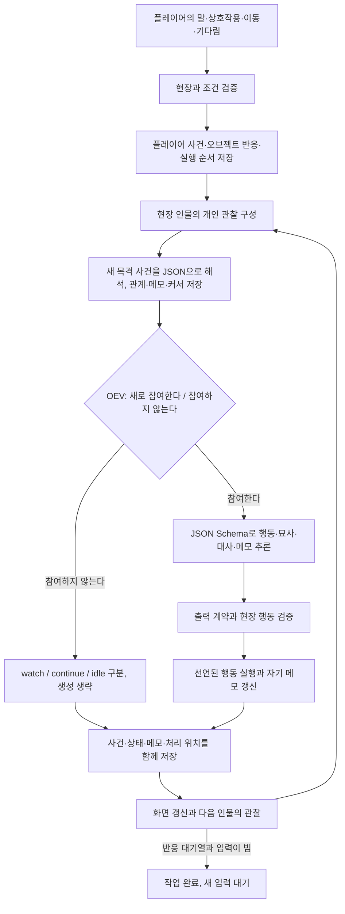

# newera의 무대 실행 구조

현재 구현의 구조와 수명주기를 설명한다. 타입과 검증의 기준은 `src/lib/theater/types.ts`, `validation.ts`다.

동적 동행과 더 풍부한 개인 메모의 확장 제안은 [반응형 씬 실행기 확장 설계](REACTIVE_SCENE_DESIGN.md)에 정리한다. 행동 여부 판단과 구조화된 상세 생성, 기본 개인 메모, 반복 반응과 진행 중 채팅은 현재 구현에 반영되어 있다.

## 세계관, 씬, 인스턴스

`World`는 세계관 정의(`definition`)와 현재 진행(`state`), ID, 리비전을 소유한다. 정의에는 가장 큰 배경·규칙, 씬, 캐릭터·오브젝트 원형, 초기 배치가 있다. 씬은 이름·설명·출구를 가지며 인스턴스의 `sceneId`가 실제 현장 구성을 결정한다.

원형은 공유하는 설명·성격·목표·초기 상태·상호작용·사건 반응을 정의한다. 인스턴스는 고유 ID, 원형 참조, 현재 씬, 이름, 상태, 활성 여부, 동행 여부, 개인 기억을 소유한다. 같은 원형에서 만든 두 작업등을 켜도 서로의 상태는 변하지 않는다.

동행은 캐릭터 인스턴스의 수명주기다. 플레이어가 출구로 이동하면 현재 씬의 동행이 같은 ID·상태·기억을 유지하며 이동한다. 동행의 독자적인 이탈 이동은 후보에서 제외하지만 대사와 상호작용은 스스로 고른다. 일반 현지 인물은 각자 이동을 고를 수 있다.

## 세션 모델과 재시도

세션의 범위는 현재 세계관이다. `theater_worlds.model_settings_json`에 판단·생성 모델 ID를 각각 저장하고, null이면 기본 모델 설정을 사용한다. 모델 설정 패널을 열거나 목록을 갱신할 때만 `/api/models`가 OEV 목록을 조회한다. `task=generation` 모델만 선택할 수 있고 서버에서 목록과 다시 대조한다. 목록 조회 실패가 공연 화면 전체의 진입을 막지는 않는다.

설정 변경은 진행 리비전을 올리지 않으며 진행 중인 작업을 취소하지 않는다. 작업 수락 시 선택한 두 모델 ID를 `theater_jobs.models_json`에 저장한다. worker 재시작 시에도 이 값을 사용하며 변경한 모델은 다음 작업부터 적용한다. 모델 선택은 운영 설정이므로 슬롯·세계관 내보내기에는 포함하지 않으며 진행 초기화와 슬롯 불러오기에도 유지한다.

모델 목록·판단·상세 생성은 각각 독립적인 재시도 경계를 가진다. 408·429·500·502·503·504, 연결·개별 요청 시간 초과, 잘못된 모델 출력은 기본 최대 2회 추가 시도한다. 지수 백오프는 1000ms를 기준으로 배가하고 ±20% 지터와 8000ms 상한을 적용한다. 횟수와 간격은 기존 모델 설정 파일·환경 변수로 설정하고, 수락한 호출 묶음은 설정 스냅샷을 유지한다. 재개한 worker는 저장한 모델 ID를 유지하며 연결·재시도 설정은 현재 유효 설정을 읽는다.

각 재시도 전에 세계관 리비전·작업 소유권을 확인한다. 백오프 중에도 취소 신호를 처리한다. 성공한 판단은 상세 생성 실패 때문에 다시 하지 않고, 이미 저장한 행동도 재실행하지 않는다. 설정·모델 선택 오류와 재시도 대상 밖의 HTTP 오류는 바로 실패한다. 모든 시도가 실패하면 마지막 오류와 총 시도 횟수를 저장하며 앞서 확정한 사건은 유지한다. 형식 검증을 생략하거나 일반 문자열로 대체하는 복구는 사용하지 않는다.

## 사건과 반응

각 인물의 완성된 행동을 메모리의 복제본에서 검증하고 저장한다. 대상을 지정했으면 그 인물이 먼저 반응하고 나머지는 배치 순서를 따른다. 시작 시 현장 인물의 ID로 반응 대기열을 만들고 순서대로 평가한다. 새 행동·발언·오브젝트 변화가 확정되면 그것을 목격한 다른 현장 인물을 다시 예약한다. 이미 대기 중인 인물은 중복 예약하지 않으며 기존 순서를 유지한다. 자신의 말만으로 스스로를 다시 호출하지 않는다. 지켜보는 선택은 공개 기록으로 남고, 하던 일을 계속하거나 아무것도 하지 않는 선택은 내부 상태로만 저장한다. 비참여 선택 자체는 다음 반응을 만들지 않는다. 다른 씬으로 이동한 인물은 그 씬에 남고, 무대 밖 인물은 따로 시뮬레이션하지 않는다.

실행기가 현장에서 만드는 후보에는 현장 인물·플레이어에게 `speak`, 조건이 맞는 `interact`, 연결된 씬으로 `move`가 있다. 행동 여부를 판단한 뒤 생성 모델이 전체 후보 중 실제 행동 ID를 추론한다. 기다림은 판단에서만 선택하므로 생성 후보에서 제외한다. 플레이어의 입력 대사는 분류기를 거치지 않고 발화 사건이 된다. 플레이어의 오브젝트 상호작용과 이동은 명시적인 선택으로 실행한다.

`/systemone`에는 단계별로 필요한 정보만 재구성해 한 번에 하나의 `choice` 질문을 보낸다. `participation`으로 먼저 참여 여부를 고르고 `wait`일 때만 더 작은 입력으로 `inactivity`를 별도 요청한다. 참여 여부는 `act` 또는 `wait`이며, 구체적인 새 행동이나 대사는 생성 단계에서 정한다. `wait`일 때는 `watch`(주의를 기울여 지켜봄), `continue`(이미 하던 일을 이어감), `idle`(아무것도 하지 않음)을 구분한다. 세 경우 모두 상세 행동 생성을 생략한다. `watch`만 공개 사건을 만들고 `continue`와 `idle`은 현재 인스턴스의 비공개 `inactivity`에 모드·선택 tick·모델을 저장한다. 새 서술·목격 기억·작업 완료 효과는 만들지 않는다. 새 사건이 생기면 다시 참여할 수 있고 실제 행동을 하면 비참여 상태를 해제한다. 횟수 제한으로 대화를 종료하지 않고 반응 대기열이 비면 작업을 완료해 새 입력을 기다린다. 판단 기록에는 행동 여부·판단 모델과 실제 행동 ID·생성 모델을 남긴다. 예전에 저장한 반응 신호·강도 필드는 읽을 수 있지만 새 판단에서는 만들지 않는다.

생성 모델은 `response_format: json_schema`로 `actionId`, `targetId`, `narrative`, `utterance`, `memoUpdate`를 출력한다. 행동 ID의 enum에는 모든 실행 후보를 넣으며 대상 ID도 해당 후보의 대상과 일치해야 한다. 주체 ID는 실행기가 현재 인물의 ID로 고정한다. 모델이 `actorId`를 출력하거나 다른 인물의 행동으로 바꿀 수 없다. 말하기는 대사가 필수이고 다른 행동의 대사는 null이어야 한다. 이동·상호작용은 구체적 묘사도 필요하다. 임의의 추가 필드·후보 밖 행동·잘린 출력은 거부하며 일반 문자열로 자동 전환하지 않는다. 실제 상태 변화는 허용된 행동과 원형의 조건·효과를 실행기가 적용한다. 텍스트에 잘못된 내용을 쓰는 것까지 타입이 보장하지는 않는다.

화면과 내려받는 공연 기록은 `narrative`를 행동 설명, `utterance`를 대사 인용문으로 분리한다. 합쳐진 `text`를 중복 표시하지 않는다. 분리 필드가 없는 기존 기록과 플레이어 입력은 사건 종류에 따라 말하기는 대사, 그 외는 행동으로 표시한다. 이동의 생성 묘사는 출발 사건에 붙이고 도착 사건은 별도로 표시한다.

## 상대별 관계와 관찰 해석

인스턴스의 `relationships`에 상대별 신뢰도·호감도·친밀도·존중도·경계도(0~100 또는 미평가 null), 짧은 인식과 최근 갱신의 근거 사건 ID를 저장한다. 초기 관계는 원형이 아닌 spawn에 두며 방향별로 독립적이다. 현재 관계와 `reflectedThroughEventId`는 상태 JSON·슬롯·내보내기에 보존한다. 기존 version 2의 생략된 필드는 빈 관계·null 커서로 읽는다.

`Director.reflect()`가 세션 생성 모델의 `character_reflection` JSON Schema로 새 목격 사건을 최대 4개씩 해석한다. 새 사건과 이전 근거를 중복 없이 나누어 전송한다. 자기 행동과 단순 기다림은 제외한다. 관계·메모·해석 위치를 먼저 원자적으로 저장한 다음 갱신된 입력으로 act/wait를 판단한다. 기다리는 인물도 관계는 바뀔 수 있고 개인 해석은 다른 인물을 깨우거나 공개 사건을 만들지 않는다. 같은 사건을 중복 평가하지 않으며 새 채팅이 도착하면 미확정 해석을 버린다. 대상·수치·실제 목격 근거를 검증하고 기존 재시도 정책을 적용한다.

상세 계약·예제·화면·설정은 [캐릭터 관계 문서](CHARACTER_RELATIONSHIPS.md)를 따른다.

## 관찰과 기억

사건은 해당 씬의 활성 캐릭터에게만 목격 기억으로 남는다. 이동에는 출발 씬의 `leave`와 도착 씬의 `enter`가 발생하며 동행도 이를 관찰한다. 다른 씬에 있던 인물은 이전 대화를 받지 않는다. 개인 상태·목표·기억은 해당 인물의 입력에만 넣는다. 다른 현장 캐릭터는 이름·설명으로, 오브젝트는 설명과 현재 상태로 관찰한다.

일반 관찰에는 최근 개인 기억 16개와 실제 목격한 사건 12개를 전달한다. 판단 직전에 LanceDB로 이 범위 밖의 과거 목격 사건을 검색해 보충한다. BM25와 OEV `embeddinggemma2` 벡터 검색을 RRF로 결합하며, 참여 판단에는 최대 2개, 검수에는 기본 최대 4개의 원문을 별도 `recalledEvents`로 전달한다. 임베딩과 색인은 조회할 때 점진적으로 갱신한다. 전체 기록과 목격 범위의 원본은 SQLite이며 색인은 권위 있는 기억 저장소가 아니다. [검색 계약](MEMORY_SEARCH.md)을 따른다.

상세 행동·대사 생성만 최근 건수 제한을 벗어나 전체 목격 기록에서 약 32K 추정 토큰의 최신 연속 구간을 `history`로 전달한다. 대화·행동·이동·상태 변화의 원문과 실제 주체/대상·장소를 보존하며, 예산 초과 시 오래된 사건 단위로 제외한다. 생성 입력에 같은 사건을 최근 기록과 검색 결과로 중복하지 않는다. typed decision·새 사건의 관계 해석은 이전 크기를 유지하며 저장된 원본은 자르지 않는다. [생성 히스토리](GENERATION_HISTORY.md)를 따른다.

목격 기억은 `eventId`, `tick`, `sceneId`, `kind`, `actorId`, `targetId`, `body`와 상호작용·목적지·효과 메타데이터를 가진 JSON이다. `body`의 `narrative`와 `utterance`는 각각 행동과 발언이며 주체·대상은 별도 필드다. 이벤트의 본문을 확정한 뒤 목격자에게 전달하므로 행동과 말이 합쳐진 문자열을 다시 분석하지 않는다. 화면용 `나`라는 표시명을 모델 기억에 넣지 않으며 플레이어는 항상 `player` ID로 구분한다.

기존 version 2 문자열 기억은 `eventId`가 가리키는 원래 사건으로 읽고 검증 시 구조화된 기억으로 바꾼다. 연결된 사건이 없는 문자열은 그대로 보존하고 화면에서 이전 기록으로 표시하되 모델 입력에서는 제외한다. 구조화된 기억의 주체·대상이 원래 사건과 다르면 거부한다. 모델에는 사건 기록을 개인 메모보다 우선하고 타인의 발언은 그 사람의 주장으로 읽도록 지시한다. 이는 주체와 출처를 명확히 하는 계약이며 자연어의 모든 주장과 해석이 사실임을 보장하지 않는다.

개인 메모는 `summary`, `currentIntention`, `feelings`, `openThreads`로 구성하며 해당 인물의 판단·생성 입력에만 넣는다. 검증된 `memoUpdate` 객체가 있으면 자기 메모 전체를 교체하고 null이면 유지한다. 다른 인물의 메모나 실제 세계 상태는 수정할 수 없다. 메모는 진행·저장 슬롯·내보내기에 보존된다. 기존 version 2 파일에서 메모가 생략되어 있으면 null로 읽는다.

오브젝트의 상호작용은 자신의 상태 조건을 검사하고 선언된 `effects`만 적용한다. 사건 반응은 `on`, `targeted`, `conditions`가 맞으면 자신의 상태를 바꾸고 `change` 사건을 낸다. 반응으로 발생한 변화 사건은 같은 패스에서 재귀적으로 전파하지 않아 무한 반응을 막는다. 임의 스크립트 실행은 지원하지 않는다.

## 저장과 작업 소유권

`theater_worlds` 행은 세계관마다 정의·진행·리비전과 모델 선택을 소유한다. 전역 선택 ID는 화면에서 어떤 세계관을 여는지만 결정하며 다른 세계관의 상태를 교체하지 않는다. 작업은 `world_id`, 현재 진행 리비전과 요청, 모델 ID 스냅샷, `progress_json`(pendingActorIds: 반응 대기열, completedDecisions: 누적 판단 횟수, consumedInputs: 추가 채팅 소비 위치), `inputs_json`(진행 중 수신한 채팅)을 저장하고 세계관당 하나만 활성화한다. 서로 다른 세계관의 작업은 독립적으로 실행할 수 있다. 기존 DB에는 필요한 열만 추가하며 기존 씬 상태는 보존한다.

worker는 15초 lease와 3초 heartbeat를 사용한다. 요청이나 상태 조회가 대기·만료 작업을 재개한다. 플레이어 사건을 먼저 저장하고, 각 인물의 검증이 끝나면 사건·효과·기억·메모·다음 처리 위치를 한 트랜잭션에 저장한다. 세계관과 작업의 리비전도 함께 전진시킨다. `finishJob()`은 반응 대기열과 미처리 입력이 모두 비었는지 트랜잭션 안에서 확인하고 완료 상태만 기록한다. 완료 직전에 입력이 도착했다면 같은 작업을 이어간다.

각 저장 직전에 소유권과 리비전을 확인한다. 모델 대기 중 외부 편집이나 실행권 상실을 발견하면 AbortSignal로 요청을 중단한다. 뒤의 인물에서 오류가 나도 앞서 확정한 결과는 유지한다. 재시작으로 만료된 작업을 회수하면 저장된 반응 대기열과 채팅 소비 위치에서 이어가므로 플레이어 입력·완료된 행동을 중복 적용하지 않는다. 옛 actorIds/nextActorIndex 진행 기록은 남은 인물 대기열로 읽는다. 저장 전에 중단된 모델 요청은 다시 추론할 수 있다.

진행 중 채팅은 활성 작업의 `inputs_json`에 수신 순서로 저장한다. 채팅 전송은 폴링 사이의 오래된 화면 리비전도 허용하되 대상은 현재 씬에서 검증한다. 입력은 다음 판단·행동 확정 전에 우선 반영하고 그 사건과 소비 위치를 함께 저장한다. 새 입력이 추론 도중 도착하면 이전 관찰의 미확정 결과를 버리고 다시 판단한다. 이미 확정한 사건은 유지한다. «그만»은 자연어 발화로 처리하며 인물의 수용·계속 여부는 기존 act/wait 판단에 맡긴다. 생성 중 이동·상호작용은 계속 제한한다.

화면은 생성 중 250ms 간격으로 작업 리비전을 조회하고, 새 리비전이나 종료 상태가 보이면 페이지 데이터를 다시 받아 즉시 렌더링한다. 인물 하나의 결과가 단위이며 토큰이나 미완성 JSON은 전송하지 않는다. 새로고침해도 저장된 중간 결과와 진행 수를 볼 수 있다.

설정 편집·슬롯 불러오기·진행 초기화는 리비전을 올린다. 슬롯 저장과 화면의 세계관 전환은 진행 리비전을 바꾸지 않는다. 슬롯은 정의와 진행을 함께 보관한다. JSON 가져오기는 전체 참조와 상태를 먼저 검증한 뒤 새 세계관으로 삽입한다.

저장소는 `theater_worlds`, `theater_meta`, `theater_saves`, `theater_jobs`로 구성한다. 씬 기반 version 2 파일만 가져올 수 있으며 구형 형식의 변환·자동 이전·원본 아카이브 보관은 지원하지 않는다.

## 현재 범위

2D·3D 그래픽 엔진은 없고, 씬은 텍스트 공간과 연결 관계다. 플레이어 입력으로 현장의 반응을 시작하고 새 사건에 대한 반응이 남아 있는 동안 인물 간 대화를 이어간다. 실시간 배경 시뮬레이션, 동적 인스턴스 소환·삭제, 인벤토리와 범용 스크립트는 구현하지 않는다. 새로운 반응은 선언된 원형·상태·조건·효과로 확장한다.
