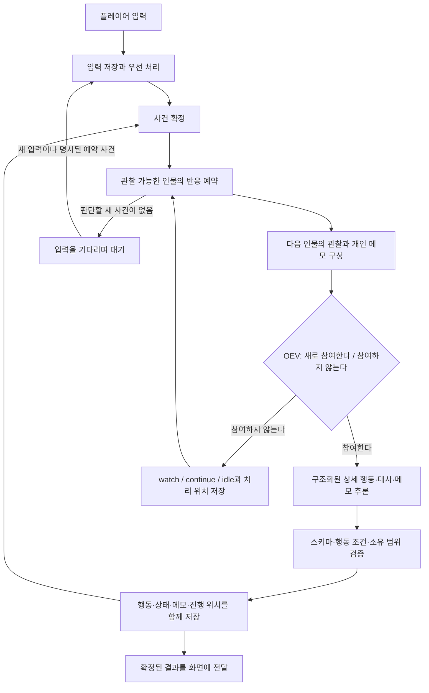

# 반응형 씬 실행기 확장 설계

상태: 확장 설계. 행동 여부 판단·구조화된 상세 생성·기본 개인 메모·인물별 저장과 중간 결과 표시·사건 기반 반복 반응·생성 중 채팅 대기열·상대별 관계와 관찰 해석은 반영했다. 동적 동행·요청 ID 중복 방지·세대별 취소 등은 확장 제안이다.

작성일: 2026-10-22 KST. 초기 검토 기준: `8bbc412`; 이후 행동 여부와 상세 생성의 분리를 작업 트리에 반영했다.

이 문서는 동적 동행, 구조화된 출력, 반복되는 인물 반응, 캐릭터별 동적 메모를 실제 실행기에 반영하는 방법을 설명한다. 현재 동작은 [PRODUCT.md](PRODUCT.md), 현재 데이터 계약은 [types.ts](../src/lib/theater/types.ts)와 [validation.ts](../src/lib/theater/validation.ts)가 기준이다. 아래의 동행 관계·근거가 있는 믿음·사건 순번·별도 지속 세션 상태는 제안이며 현재 코드와 구분한다.

## 1. 반영할 요구사항과 현재의 차이

| 항목 | 사용자에게 확인된 방향 | 현재 구현 |
| --- | --- | --- |
| 동행 | 선택·행동에 따라 합류하거나 이탈하는 동적 상태 | 인스턴스의 `companion`을 편집 화면에서 지정. 실행 중 합류·이탈 행동은 없고 동행의 독립 이동은 제외 |
| 출력 | 판단은 행동 여부만, 상세 행동·말은 구조화된 출력 추론 | OEV의 act/wait 판단 후 JSON Schema로 행동 ID·묘사·대사·메모를 생성하고 검증 |
| 반응 횟수 | 한 인물이 여러 번 말하고 행동할 수 있음. 장면 속 중단 요구도 인물의 판단 대상 | 새 행동을 목격한 다른 현장 인물을 다시 예약. 채팅도 진행 중 저장·반영하고 act/wait를 재판단 |
| 캐릭터 정보 | 기본 설정·성격과 별도로 동적인 메모를 유지 | 기본 개인 메모(summary/currentIntention/feelings/openThreads)를 생성 응답으로 갱신. 근거 사건·믿음별 수정은 제안 |

세계관 → 씬 → 인스턴스의 구조와 원형 공유는 유지한다. 관계의 다섯 수치는 모델의 관찰·판단 자료로 사용하며, 고정된 관계 증감 계산식이나 행동 임계값은 도입하지 않는다. 판단과 대사 생성의 기본 모델도 현재와 같이 `gemma4-26b`를 사용한다.

## 2. 전체 구조

현재는 «입력과 사건 → 반응할 인물 선택 → 행동 하나 확정 → 다음 사건»의 반응 대기열로 실행한다. 별도의 세션 상태·사건 순번 등은 아래의 추가 확장 제안이다.



한 세계관의 상태 변경은 하나의 writer가 순서대로 확정한다. 모델 응답을 기다리는 동안에는 DB 트랜잭션을 열어두지 않는다. 첫 구현은 모델 판단도 세계관 안에서 직렬로 처리해, 앞선 행동을 다음 인물이 실제로 관찰하도록 한다. 인물별 객체는 자신의 상태·메모·관찰 위치를 소유하고, 씬 실행기는 사건 전달과 실행 순서를 맡는다.

## 3. 동행을 행동으로 바뀌는 관계로 표현

### 3.1 데이터

원형에는 동행을 고정 속성으로 두지 않는다. 초기 배치에는 시작 관계를 지정할 수 있지만, 실행 이후의 권위는 인스턴스 상태에 둔다.

다음은 제안하는 표현이다.

```ts
interface FollowingState {
  leaderId: string | null;
  changedByEventId: string | null;
}

interface CharacterRuntime {
  following: FollowingState;
  memo: CharacterMemo;
  observedThroughSeq: number;
}
```

플레이어의 현재 동행 목록은 `following.leaderId === 'player'`인 캐릭터들로 계산한다. 초기 구현은 플레이어 동행을 우선 지원하되, 관계의 대상을 ID로 표현하면 이후 캐릭터 간 동행도 같은 방식으로 확장할 수 있다. 캐릭터 간 동행까지 첫 단계에 구현하는 것은 필수 조건으로 두지 않는다.

`leaderId`는 같은 세계관의 유효한 캐릭터 또는 플레이어만 가리킬 수 있다. 자기 자신이나 오브젝트를 가리킬 수 없고, 캐릭터 간 동행을 지원할 때는 순환 관계도 거부한다. 원형·초기 배치를 편집하는 일과 현재 동행을 변경하는 일은 구분한다.

### 3.2 선택과 결과

실행기가 만드는 행동 후보에 `invite_follow`, `follow`, `leave_follow`를 추가한다. 초대는 상대의 판단을 깨우는 사건이며, 초대만으로 상대의 관계를 바꾸지 않는다.

예를 들어 플레이어가 하린에게 같이 가자고 말하면, 하린은 자신의 성격·메모·상황을 보고 따라가기·거절하기·대화 이어가기 중에서 선택한다. 하린이 `follow:player`를 고른 경우에만 실행기가 하린의 동행 관계를 바꾼다. 하린이 다른 사건 때문에 먼저 동행을 끝내거나, 다른 인물의 설득을 듣고 선택을 바꾸는 것도 같은 경로로 처리한다.

주체가 자신의 동행 관계를 바꾸는 행동과, 다른 주체에게 변화를 요구하는 행동을 타입으로 구분한다. 모델이 임의의 제삼자에게 `companion=true`를 쓰는 범용 상태 수정은 허용하지 않는다. 물리적인 분리처럼 실행 규칙이 만드는 변화는 해당 원인 사건을 기록한다.

### 3.3 이동

동행을 선택한 캐릭터는 그 관계가 유지되는 동안 연결된 씬으로 함께 이동할 수 있다. 이동 직전에 최신 관계와 이동 조건을 다시 확인한다. 이전 생성에서 확보한 동행 목록을 계속 재사용하지 않는다.

현재 씬에 있고 같은 경로로 이동할 수 있는 캐릭터만 함께 이동한다. 떨어진 씬의 인물을 순간이동시키지 않는다. 관계는 유지되지만 물리적으로 분리된 경우에는 그 상태를 표시하고, 이후 합류·관계 해제 판단으로 이어가도록 한다. 따라서 지금의 «모든 활성 동행은 반드시 플레이어와 같은 씬»이라는 검증도 변경해야 한다.

## 4. 기본 설정, 현재 상태, 기억, 메모를 구분

상대별 신뢰도·호감도·친밀도·존중도·경계도와 인식·근거, 행동 판단 전 관찰 해석은 현재 반영되어 있다. 별도 제안인 믿음 관리와 구분하며 구현 계약은 [캐릭터 관계 문서](CHARACTER_RELATIONSHIPS.md)를 따른다.

| 정보 | 소유 위치 | 용도와 변경 방식 |
| --- | --- | --- |
| 기본 설정·성격 | 캐릭터 원형 | 배경과 지속적인 행동 성향. 시나리오 편집으로 변경 |
| 현재 상태 | 캐릭터 인스턴스 | 실제 위치·동행 관계·현재 자원 등. 검증된 행동과 실행 규칙으로 변경 |
| 목격 기억 | 캐릭터 인스턴스 | 실제로 보거나 들은 사건의 기록. 관찰 범위에 따라 누적 |
| 동적 메모 | 캐릭터 인스턴스 | 지금의 의도·감정·해석·미해결 문제. 새로 관찰한 사건에 따라 갱신 |

동적 메모는 대화 원문을 한 번 더 쌓는 목록이 아니다. 인물이 다음 선택을 할 때 필요한 현재 관점을 짧게 유지하는 자료다. 실제 동행 관계나 오브젝트의 상태를 메모의 문장으로 판정하지 않는다.

현재 구현은 아래 제안 중 `summary`, `currentIntention`, `feelings`, `openThreads`를 사용한다. 생성 응답은 이 네 필드 전체를 교체하거나 null로 갱신을 생략한다. `beliefs`, `updatedThroughSeq`와 믿음 단위 수정은 후속 확장이다.

```ts
interface MemoBelief {
  id: string;
  text: string;
  sourceEventIds: string[];
  basis: 'observed' | 'inferred';
}

interface CharacterMemo {
  summary: string;
  currentIntention: string;
  feelings: string[];
  beliefs: MemoBelief[];
  openThreads: string[];
  updatedThroughSeq: number;
}
```

예를 들어 하린은 «서연이 긴장하고 있다», «내가 조명을 확인하면 도움이 될 것 같다», «플레이어에게 아까 하던 질문을 아직 하지 못했다»를 메모에 남길 수 있다. 직접 들은 말과 그 말에서 추측한 의도는 구분한다. 추측을 세계의 확정 사실로 승격하지 않는다.

모델에는 자신의 기본 설정·현재 상태·메모·목격 기억과 현장 관찰만 보낸다. 다른 캐릭터의 메모·비공개 상태·관찰하지 않은 대화는 전달하지 않는다. 메모에 붙이는 근거 사건 ID도 해당 캐릭터가 관찰할 수 있는 사건인지 검증한다.

현재 목격 기억은 이미 주체 `actorId`, 대상 `targetId`, 종류 `kind`, 본문 `body.narrative`·`body.utterance`를 분리한 JSON으로 기록한다. 주체는 실행기가 붙이고 모델이 지정할 수 없다. 이전의 `나:` 같은 문자열 기억은 사건 ID에서 복원해 사용한다. 이 구조는 후속 믿음·근거 사건 설계에서도 유지한다.

메모 갱신은 해당 인물 자신에게만 허용한다. 기존 믿음의 수정·철회가 가능하도록 ID를 두고, `summary`·감정·현재 의도는 새 관찰을 반영해 교체할 수 있게 한다. 의미 있는 변경이 없으면 갱신을 생략한다. 글자 수와 항목 수는 제한하고, 오래된 내용은 요약하되 원래의 목격 사건 기록은 유지한다. 이 제한은 문맥 예산 관리이며 발화·행동 횟수 제한이 아니다.

메모는 새 채팅이 도착해 판단을 다시 할 때, 행동을 확정할 때, 일시정지 후 재개할 때 이어서 사용한다. 무대 밖 인물의 메모를 현장의 사건으로 갱신하지 않는다.

## 5. 구조화된 출력의 역할

### 5.1 판단과 표현을 분리

`/v1/systemone`은 같은 요청의 `participation` choice로 **참여한다(`act`) / 새로 참여하지 않는다(`wait`)**를 판단하고, `inactivity` choice로 **지켜봄(`watch`) / 하던 일 계속(`continue`) / 아무것도 하지 않음(`idle`)**을 구분한다. 후자의 답은 `wait`일 때만 사용한다. 구체적인 새 행동·대상·대사·강도는 여기서 고르지 않는다. `noul`·`score` 질문과 반응 임계값은 제거했다. 비참여는 상세 생성을 생략하며, `continue`와 `idle`은 내부 선택만 저장하고 공개 사건·목격 기억·작업 완료를 생성하지 않는다. 새 사건이 생기면 다시 판단한다.

이 판단은 해당 인물이 지금 행동하는지만 결정한다. 씬 전체의 종료를 결정하지 않는다. 강한 감정이라는 이유만으로 계속 행동하도록 강제하지도 않는다. 감정·의도·중단 요구를 관찰 입력에 포함하고, 상세 행동은 이후 생성 모델이 추론한다.

행동하는 경우 `/v1/chat/completions`의 `response_format: json_schema`로 상세 행동·묘사·대사·메모를 함께 추론한다. `actionId` enum에는 기다림을 제외한 현장의 모든 합법적인 행동 ID를 넣고, 생성 모델이 그중 하나를 선택한다. 대상·목적지·상호작용 효과는 실행기가 ID로 확인한다. 말하기에는 대사가, 이동·상호작용에는 행동 묘사가 필요하다. 다음은 현재 구현의 출력 예다.

```json
{
  "actionId": "speak:seoyeon",
  "targetId": "seoyeon",
  "narrative": "조명 쪽을 가리키며 서연에게 말을 건다.",
  "utterance": "서연, 내가 조명부터 확인해 볼게.",
  "memoUpdate": {
    "summary": "서연이 긴장한 듯해 준비를 돕고 싶다.",
    "currentIntention": "공연 준비를 도와 서연의 부담을 덜어준다.",
    "feelings": ["서연이 걱정됨", "먼저 도울 의향이 있음"],
    "openThreads": ["조명을 확인해도 되는지 서연의 답을 기다린다."]
  }
}
```

이 예제의 ID는 형식 설명용이다. 실제 요청에는 현재 후보의 ID를 넣는다. 다섯 출력 필드는 모두 필수이고 `additionalProperties: false`를 사용한다. `targetId`가 선택한 행동의 대상과 다르면 거부하며, 주체는 실행기가 현재 인물의 ID로 붙인다. `memoUpdate: null`이면 기존 메모를 유지하며, 객체이면 네 메모 필드 전체를 교체한다. 빈 배열은 해당 목록을 비운다. 향후 `beliefs`를 추가하면 부분 수정·삭제 계약도 별도로 정의한다.

위치·동행·오브젝트 상태는 선택된 행동과 선언된 효과를 실행기가 반영한다. 더 풍부한 상태 변화가 필요하면 허용된 변화 종류와 대상을 가진 별도의 typed effect를 추가한다. 임의 JSON 경로나 제삼자의 상태를 수정하는 패치는 도입하지 않는다.

### 5.2 검증과 오류 처리

검증은 JSON 파싱, 스키마 검증, 현재 세계관에 대한 실행 가능성 검증 순서로 한다. 행동 ID·화자·대상·목적지·메모 소유자·근거 사건을 확인한다. 올바른 JSON이라고 해서 서술과 해석까지 정확하다고 보장되지는 않는다.

새 입력이나 편집 때문에 관찰 이후 상태가 달라졌으면, JSON이 유효해도 이전 제안을 그대로 적용하지 않는다. 최신 관찰로 다시 판단한다.

현재는 JSON 오류·잘림·실행 불가능한 행동을 받으면 해당 결과를 저장하지 않고, 기본 최대 2회 백오프 후 재생성한다. 408·429·500·502·503·504와 연결·요청 시간 초과도 같은 제한 안에서 재시도한다. 성공한 판단과 이미 저장한 행동은 반복하지 않는다. 계속 실패하면 시도 횟수와 오류를 저장하고, 플레이어 입력과 앞서 확정한 결과는 유지한다. 일반 문자열 대체는 없다. 이후에는 검증 오류를 재생성 입력에 첨부하는 방식을 추가로 검토할 수 있다.

향후 다른 provider의 호환성 문제로 `json_schema`를 사용할 수 없으면 명시적인 설정으로 `json_object`와 클라이언트 검증을 지원할 수 있다. 현재는 이 대체 경로를 구현하지 않는다. 형식 실패를 이유로 타입 검증을 조용히 해제하지 않는다.

### 5.3 확인한 범위

2026-10-22에 로컬 OEV의 [OpenAPI](http://macstudio:12821/openapi.json)에서 `text`, `json_object`, `json_schema`와 `/v1/systemone`을 확인했다. `gemma4-26b`에 `utterance`, `memo` 두 문자열을 요구하는 간단한 JSON Schema를 보내 정상 JSON과 `finish_reason: stop`을 받았다.

같은 날 실제 예제 씬에서 `gemma4-26b`의 act/wait 판단과 초기 네 필드 스키마를 확인했다. 행동 판단은 act였고, 생성은 `speak:player`와 묘사·대사·개인 메모를 반환해 클라이언트 검증을 통과했다. 모델 목록 확인 이후 판단부터 생성까지 한 표본은 약 16.3초였다. 이후 `targetId`를 추가한 다섯 필드 스키마와 구조화된 목격 기억도 확인했다. 플레이어가 작업등을 끈 기록을 받은 하린은 플레이어에게 말하는 행동을 선택하고, 메모에도 플레이어가 끈 것으로 기록했다. 이는 연결과 단일 사례 확인이며 성공률·지연 분포의 측정은 아니다. 제안하는 믿음별 부분 갱신은 아직 검증하지 않았다. [서버 제공 문서](http://macstudio:12821/.skill)는 JSON 출력 검증을 지원한다고 설명하지만 grammar 기반 제약 디코딩은 지원하지 않는다고 명시한다. 따라서 디코딩 단계에서 항상 스키마를 지킨다고 가정하지 않는다.

## 6. 한 번씩 도는 턴 대신 사건을 처리하는 세션

### 6.1 반복과 대기

기본 반영 완료: `resolveTurn()`은 반응 대기열을 순회한다. 새 행동을 목격한 다른 인물을 다시 예약하고, 같은 인물이 같은 진행에서 여러 번 선택될 수 있다. `wait` 자체는 다음 반응을 예약하지 않는다. 현재 작업은 대기열과 입력이 비면 completed로 남으며 별도 idle 상태는 아래의 확장 제안이다.

새 사건이 확정되면 관찰 가능한 인물의 미처리 사건 범위를 갱신하고 반응을 예약한다. 대상을 지정한 말, 직접 관련된 행동, 미해결 문제와 관련된 사건을 우선하되 같은 인물만 계속 실행되지 않도록 대기 순서를 고려한다. 첫 구현은 현장 인물을 다시 평가하는 단순한 큐로 시작하고, 선택 결과가 `wait`이면 새 관련 사건이 생길 때까지 그 인물을 다시 호출하지 않는다.

`wait`는 판단 결과와 처리 위치를 저장하지만, 그 자체로 다른 인물을 깨우는 새 장면 사건을 무조건 만들지 않는다. 모든 인물이 기다리면 세션은 `idle`로 남아 입력을 기다린다. 이 상태는 인원수만큼 행동한 뒤 장면을 강제로 종료하는 것과 다르다. 새 입력이나 명시적으로 예약된 사건이 들어오면 다시 진행한다. 폴링만으로 같은 관찰을 끝없이 추론하지 않는다.

계속할 사건과 선택이 있으면 동일 인물이 여러 차례 말하거나 행동할 수 있다. 작업을 작은 실행 배치로 나눌 수는 있지만, 배치 시간이나 처리 개수를 초과했다고 이야기 속 대화가 끝난 것으로 기록하지 않는다. 진행 위치를 저장하고 이어서 실행한다.

### 6.2 진행 중 입력과 중단 요구

플레이어의 채팅 입력은 생성 중에도 열어둔다. 사용자가 «잠깐, 그만해»라고 말하면 즉시 입력을 저장하고, 다음 행동 확정 전에 그 발화를 먼저 반영한다. 이미 확정된 말과 행동을 취소하지는 않는다.

인물은 중단 요구를 관찰하고 수용·반박·설명·계속 행동·동행 이탈 등을 선택할 수 있다. 사용자가 말했으므로 모든 인물이 자동으로 멈추게 하거나, 감정이 격앙됐으므로 반드시 계속하게 하지 않는다. 그때의 성격·동적 메모·상황에 따라 선택한다.

운영 조작으로서의 **실행 일시정지**는 별도로 제공하는 것을 제안한다. 이 조작은 모델 선택을 기다리지 않고 진행을 정지시키며, 장면 안에서 캐릭터가 이를 거부하는 사건을 만들지 않는다. 재개 시 확정된 상태에서 이어간다. 명시적인 입력 모드나 버튼으로 구분하고, 자연어의 «그만»을 임의로 운영 명령으로 바꾸지 않는다.

### 6.3 생성 도중 입력이 도착하는 경우

1. 클라이언트가 세계관 ID와 요청 ID를 붙여 입력을 전송한다.
2. 서버는 입력을 내구성 있는 대기열에 넣는다. 응답을 기다리던 이전 모델 요청은 취소할 수 있다.
3. writer는 새 입력을 다음 행동보다 우선 처리하고 관찰을 갱신한다.
4. 모델이 취소보다 먼저 응답해도, 그 응답이 본 리비전과 입력 처리 위치를 확인한다.
5. 반영하지 않은 새 입력이 있거나 관찰이 오래되었으면 이전 제안을 버리고 다시 판단한다.

화면에서 입력만 가능하게 하는 것으로는 부족하다. 현재 구현은 활성 작업이 있으면 새 채팅을 그 작업의 `inputs_json`에 전달한다. 채팅 입력과 다음 소비 위치를 상태와 함께 저장한다. 요청 ID 중복 방지와 추론 도중 즉시 네트워크 취소는 아직 제안이다.

## 7. 행동마다 저장하고 확정 결과를 전달

### 7.1 첫 구현의 저장 범위

첫 구현은 기존 `theater_worlds`의 JSON 상태를 유지해 변경 범위를 제한한다. `StageEvent`에 씬의 `tick`과 별개인 사건 순번 `seq`를 추가하고, 캐릭터별 관찰·메모 처리 위치를 둔다. 같은 시간에 발화가 여러 번 일어나도 순서를 구분할 수 있어야 한다.

다음 변경을 제안한다.

| 저장 대상 | 추가할 정보 |
| --- | --- |
| `theater_worlds` | 현재 상태, 사건 순번, 실행 제어 세대 `controlEpoch` |
| 인스턴스 JSON | 동행 관계, 동적 메모, 관찰한 사건의 처리 위치 |
| `theater_jobs` | 장면 세션 상태, 현재 진행 리비전, 반응 큐와 작업 진행 위치 |
| 새 `theater_inputs` | 요청 ID, 세계관 ID, 입력 순서, 내용, pending/applied/cancelled 상태 |

`observedThroughSeq`는 개인이 관찰할 수 있는 사건 범위를 처리했다는 뜻이다. 전체 세계의 사건 내용을 개인에게 노출하는 근거로 사용하지 않는다. 한 세계관의 단일 writer가 사건 순서를 정한다.

행동 하나를 확정하는 트랜잭션에서 다음을 함께 저장한다: 실제 사건과 오브젝트 반응, 인스턴스 상태, 동행 변화, 관련 인물의 목격 기억, 행동 주체의 메모, 사건 순번, 반응 큐의 진행 위치, 작업 소유권에 연결된 진행 리비전. 요청 소비도 그 요청이 만드는 사건과 함께 확정해 재시작 후 중복 적용을 막는다.

현재 `saveJobProgress()`는 플레이어 입력 이후와 각 인물의 결과 이후에 상태·반응 대기열·누적 판단 횟수·채팅 소비 위치를 함께 저장한다. `finishJob()`은 미처리 반응·입력이 없을 때 완료 상태만 기록한다. 반복 반응과 중간 결과 표시·부분 실패 보존·재시작 시 입력 소비 복원은 반영되어 있다. 별도 세대 정보는 추가 확장 제안이다. 저장 구조가 커져 별도 사건 테이블이 필요해지는 시점에만 추가 분리를 검토하고, JSON과 별도 사건 테이블을 동시에 원본으로 두지는 않는다.

### 7.2 리비전과 복구

현재 인물별 저장마다 세계관과 작업의 리비전을 함께 전진시키고, 다음 모델 요청은 그 리비전을 기준으로 실행한다. 반응 대기열과 채팅 소비 위치를 함께 저장해 작업 회수 시 완료된 행동과 입력을 중복 적용하지 않는다. 새 채팅이 추론 중 도착하면 이전 관찰의 미확정 응답을 버린다.

슬롯 불러오기·초기화·운영 일시정지는 `controlEpoch`를 바꿔 이전 요청과 반응 큐를 무효화한다. 사건 순번이 슬롯의 시점으로 돌아갈 수 있으므로, 클라이언트와 worker는 순번만으로 이어받지 않고 이 세대도 확인한다. 새 세대가 보이면 화면은 스냅샷을 다시 받고 커서를 바꾼다. 이전 세대의 미처리 입력은 취소 상태로 남긴다.

현재의 lease·heartbeat·실행권 검증은 유지하되 행동을 저장할 때마다 확인한다. worker 재시작 시 마지막으로 확정한 행동과 입력 처리 위치에서 재개한다. 중복 HTTP 요청에는 같은 요청 ID를 사용하고, 실행 단계에도 중복 확정을 막을 식별자를 둔다.

모델 오류는 해당 제안을 실패시킬 뿐 이미 확정한 장면을 되돌리지 않는다. 세션은 오류 상태를 표시하고 확정 위치에서 재개할 수 있게 한다. 사용자의 실제 실행 정지는 자동 재개하지 않는다.

### 7.3 화면 반영

현재는 250ms 간격으로 작업 리비전을 확인하고, 중간 저장이나 종료 상태가 보이면 `invalidateAll()`로 페이지 데이터를 갱신한다. 따라서 뒤의 인물이 추론 중이어도 앞선 인물의 결과를 표시한다. 지속 세션에서는 전체 페이지 데이터 대신 사건 순번에 따른 증분 조회로 확장할 수 있고, 필요할 때 SSE로 전환할 수 있다.

화면에는 확정된 대사·행동·동행 변화만 추가한다. JSON 토큰이 생성되는 도중의 불완전한 상태를 먼저 적용하지 않는다. 채팅 입력과 실행 상태 표시는 분리하고, `generating`이라는 이유만으로 채팅 입력을 비활성화하지 않는다. 세계관 전환 후 도착한 다른 세계관의 결과도 올바른 세계관에만 반영한다.

무대 밖 인물의 상시 시뮬레이션은 이번 범위의 전제가 아니다. 현장 사건의 반복 전달부터 구현한다. 모델 호출은 실제 후보 선택과 표현이 필요할 때만 하고, 유휴 상태에서는 호출하지 않는다. 현재는 세계관별로 판단·생성 모델을 선택하고 작업 시작 때 두 ID를 저장한다. 이후 선택을 바꾸거나 worker가 재시작되어도 수락한 작업은 저장한 ID를 유지한다. 지속 세션에서는 다음 행동을 시작할 때 유효한 모델 스냅샷을 읽도록 확장하는 것을 제안한다. 한 행동의 판단과 표현은 같은 설정 스냅샷을 사용한다.

## 8. 기존 씬 데이터의 변화

동행 관계와 사건 순번을 도입할 때 씬 데이터 형식을 version 3으로 올리는 것을 제안한다. 현재의 기본 메모와 사건의 묘사·대사 필드는 version 2에 선택 필드로 추가했고, 이전 파일의 메모 생략은 null로 읽는다. 후속 변환은 현재 앱이 사용하는 씬 기반 version 2에 한정한다.

- 초기 배치의 `companion`은 초기 동행 대상 지정으로 옮긴다.
- 현재 인스턴스의 `companion=true`는 실행 상태의 `following.leaderId='player'`로 옮긴다. false는 null로 옮긴다.
- 기존 목격 기억과 기본 개인 메모는 유지한다. 추가하는 믿음·처리 위치는 빈 값이나 관찰한 기록을 근거로 초기화하며 이전에 없던 감정·관계를 만들어 넣지 않는다.
- 사건 순번과 개인 처리 위치를 일관되게 부여하고, 저장 슬롯에도 같은 변환을 적용한다.
- 새 동적 상태는 현재 진행과 슬롯에 저장한다. 원형이나 초기 배치에 역으로 덮어쓰지 않는다.

이 제안은 방금 삭제한 구형 데이터나 계산식을 복원하는 호환 계층을 의미하지 않는다. 현재 씬 기반 데이터와 새 실행기의 계약 변경만 다룬다.

## 9. 구현 순서와 관련 파일

| 단계 | 작업 | 주로 바꿀 곳 |
| --- | --- | --- |
| 1 | 동행 관계·개인 메모·사건 순번·행동별 출력 계약과 검증 정의 | `types.ts`, `validation.ts`, 작성 도구와 씬 파일 안내 |
| 2 | 행동 여부 판단과 상세 생성 분리, 기본 메모·오류·잘림 처리(반영), 근거별 메모 확장(제안) | `server/oev.ts`, `performance.ts`, `Director` 계약 |
| 3 | 합류·이탈 행동과 이동 규칙, 자기 메모 갱신 reducer | `runtime.ts`, 원형과 초기 배치 예제 |
| 4 | 인물별 원자적 저장·반응 큐·채팅 대기열·소비 위치(반영), 요청 ID 중복 방지·세대 검증(제안) | `server/stage-store.ts`, 슬롯 저장·불러오기 |
| 5 | 지속 세션과 반응 큐, 새 입력 우선 처리, 유휴·정지·재개 | `ensemble.ts`, `server/stage.ts` |
| 6 | 인물별 중간 결과·개인 메모 표시(반영), 생성 중 채팅·사건 단위 증분 조회·동행 변화(제안) | 플레이 화면, 입력 action, 상태 조회 API |

현재는 반복 반응 중 채팅 개입과 재시작 후 이어가기까지 반영했다. 아래 검증 항목 중 동행 합류·이탈, 근거 기반 믿음과 즉시 운영 일시정지는 추가 확장에 해당한다.

## 10. 확인할 대표 시나리오

1. 초대에 동의한 인물이 합류하고, 다른 인물의 말이나 자신의 목표 때문에 이후 이탈한다. 상태와 사건 원인이 함께 저장된다.
2. 같은 원형에서 만든 두 인스턴스가 서로 다른 동행 관계와 메모를 유지한다.
3. 한 인물이 여러 번 발화하고, 상대가 앞선 말에 다시 반응한다. 다른 대기 인물도 실행 기회를 얻는다.
4. 진행 중 «그만»이라는 채팅을 보내면 현재까지 확정한 사건 다음에 반영되고, 수용하거나 계속하겠다는 선택이 각각 가능하다.
5. 운영 일시정지는 장면 속 감정이나 선택과 무관하게 다음 확정을 막는다. 재개하면 중복 없이 이어진다.
6. 모델이 응답하기 직전 새 입력·동행 이탈·씬 편집·슬롯 불러오기가 발생해도 오래된 판단을 저장하지 않는다.
7. 자기 메모만 수정할 수 있고, 다른 씬에서 일어난 대화나 타인의 메모가 입력과 근거 사건에 섞이지 않는다.
8. 잘못된 JSON, 스키마 외 필드, 실행할 수 없는 행동, 잘린 출력은 실행하지 않는다. 이전에 확정한 행동은 유지한다.
9. 모든 인물이 기다리면 모델 호출이 쉬고, 새 입력으로 재개한다. `wait`만 반복하는 자기 생성 루프가 생기지 않는다.
10. 행동 저장 직후 worker가 종료되거나 요청을 재전송해도 사건·메모·동행 변화가 두 번 적용되지 않는다. 슬롯 복구도 같은 계약을 지킨다.

구조화된 출력의 실패율·출력 길이·응답 지연은 실제 OEV 문맥으로 측정한 뒤 출력 크기와 재생성 정책을 조정한다. 믿음별 메모 갱신의 실서버 검증, 자연어에서 초대·이탈 의도를 해석하는 구체적 후보 구성, 운영 일시정지 UI의 위치는 구현하면서 확정할 사항이다. 네 가지 사용자 요구 자체는 추가 확인을 기다리는 항목으로 되돌리지 않는다.
